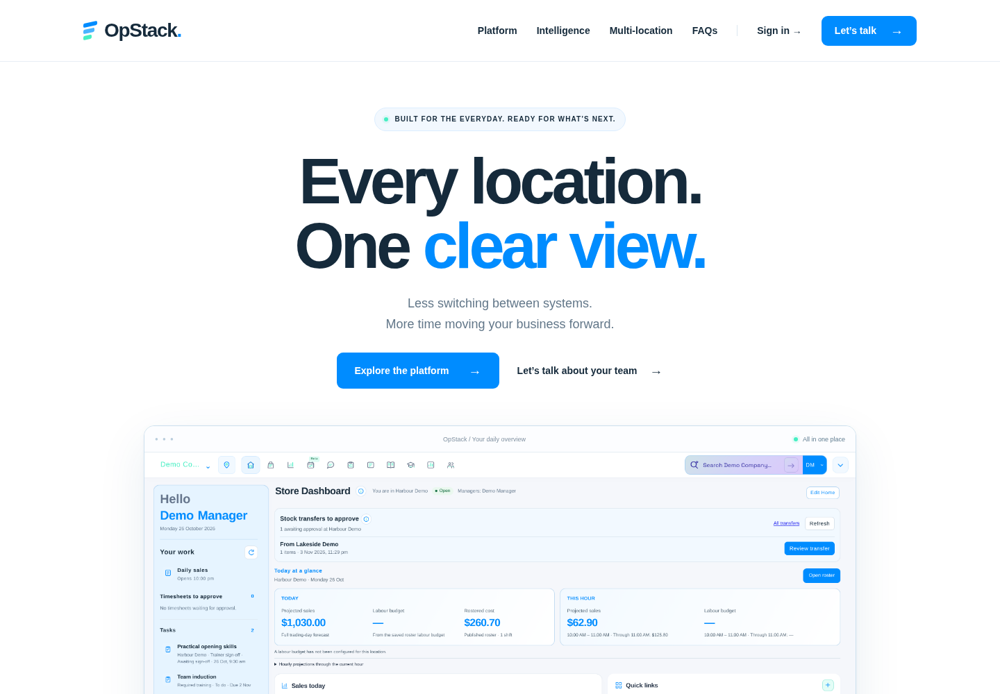

# OpStack marketing website

The public website is available at https://opstack.up.railway.app/website/ after the updated app deploys.

It includes desktop and mobile app screenshots, seven interactive product sections, OpStack intelligence, multi-location features and FAQs. Demo enquiries open an email to Demos@opstacktech.com. The site uses public demo data only and leaves the app's current entry point and authentication unchanged.

[Website source and standalone hosting instructions](../../website/README.md)

