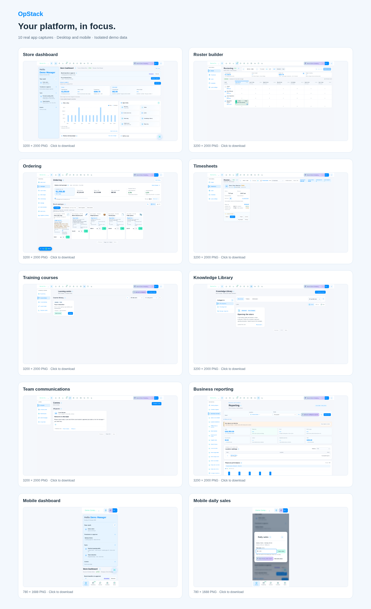

# OpStack website screenshots

[Download the screenshot pack](./OpStack-website-screenshots.zip). On the GitHub file page, choose **Download raw file** (the down-arrow button).

The ZIP contains ten genuine browser captures using isolated demo data, plus an offline preview gallery. Desktop PNGs are 3200 × 2000; mobile PNGs are 780 × 1688. No production employee, customer or account data is included.

Included views: Store dashboard, roster builder, ordering, timesheets, training courses, Knowledge centre, team communications, business reporting, mobile dashboard and mobile daily sales.

Extract the ZIP and open `index.html` to browse the images. Use the dashboard and mobile daily-sales images for a homepage showcase and the individual screens for feature sections. The current app styling and any visible Beta labels are retained.

